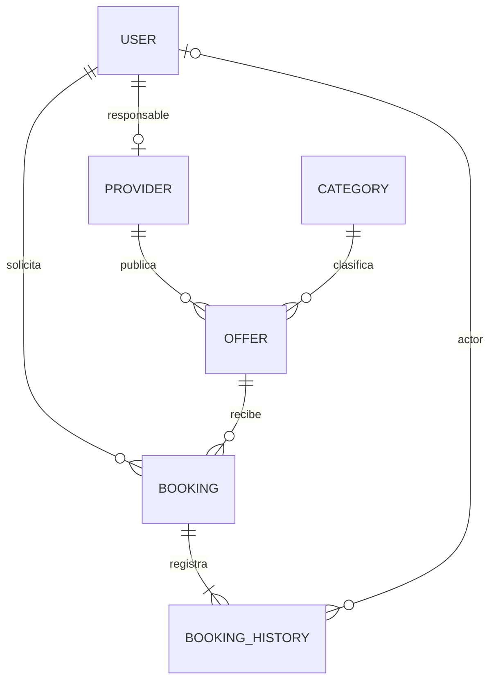

# USH Last Minute

## 1. Presentación

**Informe:** Avance de implementación y demostración funcional — Taller de Proyectos II.

**Bajada:** «Lo mejor de Ushuaia, a último momento». **Mensaje principal:** «Todavía estás a tiempo. Pagá menos».

Aplicación académica que conecta turistas con prestadores habilitados de Ushuaia para ofrecer descuentos en excursiones, estadías y alquileres de autos que comienzan dentro de las próximas 72 horas. El objetivo de esta entrega es demostrar un circuito operativo con datos ficticios y evidencia reproducible.

| Dato académico | Valor |
|---|---|
| Materia | Taller de Proyectos II |
| Carrera | Tecnicatura Universitaria en Tecnología de la Información |
| Fecha de entrega | [COMPLETAR] |
| Fecha de corte de esta implementación | 12/11/2026, America/Argentina/Ushuaia |
| Integrante: nombre y apellido | Rodrigo Herrainz |
| Legajo | 237834 |
| Correo | rherrainz@alumnos.kennedy.edu.ar |
| Repositorio | https://github.com/rherrainz/ushlm |

El nombre, legajo y correo académico se incorporaron por indicación del usuario; no se incluye DNI. El usuario autorizó el commit y push de esta entrega al repositorio enlazado el 12/11/2026. No se incluyen credenciales reales ni bases de datos.

Dominio propuesto: `ush-lm.ar`. Alternativas previstas: `ushlastminute.ar` y `ushlm.ar`. No se configuraron dominios ni despliegues.

## 2. Problema, solución y alcance

Los turistas necesitan encontrar oportunidades cercanas y conocer sus condiciones. Los prestadores necesitan ofrecer inventario remanente y confirmar únicamente la disponibilidad real. El administrador habilita prestadores y gestiona categorías y publicaciones.

La solución incluye tres perfiles: turista registrado, prestador asociado a una cuenta responsable única y administrador de Django. El registro público crea turistas; el administrador crea las cuentas prestadoras y su habilitación. No hay autoaprobación de prestadores.

Reglas implementadas:

- Solo prestadores habilitados con cuenta activa publican. Cada guardado de una publicación valida inicio futuro dentro de 72 horas, vencimiento futuro no posterior al inicio y fin posterior al inicio. Los borradores pueden prepararse antes de esa ventana.
- Una oferta representa fechas fijas. Excursiones: unidad `persona`; autos: unidad `auto`; alojamientos: unidad explícita y ocupación positiva obligatoria. No existe selector de períodos variables.
- Precio decimal positivo y menor al de referencia en la misma moneda y condiciones. El precio anterior debe referir a esa misma prestación; la veracidad comercial depende de la carga del prestador. Cupo no negativo y cantidades enteras positivas.
- El catálogo excluye vencidas, cerradas, sin cupo y cuentas prestadoras suspendidas/inactivas. Filtros por categoría y fecha local de inicio, orden por descuento relativo o vencimiento. No se comparan precios entre monedas.
- Una solicitud pendiente no descuenta cupo ni garantiza disponibilidad. Se valida el cupo al solicitar y se vuelve a validar al aceptar.
- La aceptación verifica propiedad, estado, habilitación, vigencia y cupo; bloquea prestador, oferta y solicitud en ese orden, confirma, descuenta inventario y agrega historial dentro de una transacción. No se acepta dos veces una solicitud.
- La solicitud guarda precio, moneda, descripción, condiciones y datos del servicio/prestador. Cambios posteriores no alteran esa copia histórica. Total y descuento se calculan en Python; el orden relativo se calcula en el servidor con el ORM.
- Un token UUID único evita duplicados por reenvío del mismo formulario. Una solicitud nueva deliberada con otro token es independiente.
- El turista cancela pendientes propias. El prestador rechaza pendientes o cancela confirmadas propias con motivo obligatorio. El cupo se devuelve únicamente si la oferta sigue vigente y el prestador habilitado, una sola vez.
- Las pendientes vencen al expirar su publicación; el comando periódico y los listados materializan ese estado y su historial. Incluso sin ejecutar el comando, el servidor impide aceptar una pendiente vencida. Cerrar o suspender una oferta no adelanta automáticamente el vencimiento de sus pendientes.
- Operaciones de escritura mediante POST, CSRF, validación del servidor y errores conservando los datos del formulario. Los listados requieren autenticación y filtran por propietario.
- Relaciones protegidas conservan actividad e historial. La administración no ofrece borrado de entidades ni modificación directa de solicitudes/historial.

**Exclusiones:** cobros, integraciones de inventario externo, guías freelance, múltiples destinos y reseñas. Los pagos se coordinan con el prestador y el inventario externo se carga manualmente. No se implementaron ampliaciones para aumentar el porcentaje de avance.

## 3. Tecnologías y arquitectura

Monolito Django con plantillas, CSS y JavaScript para un contador informativo basado en `expires_at` persistido. La vigencia efectiva depende del servidor, incluso si el reloj del navegador difiere. SQLite para desarrollo; PostgreSQL configurado mediante variables para producción y concurrencia.

| Componente | Versión utilizada |
|---|---|
| Python | 3.14.6 |
| Django | 5.2.19, rama LTS 5.2 |
| SQLite local | 3.54.0 |
| psycopg / psycopg-binary | 3.3.9 |
| asgiref / sqlparse | 3.13.0 / 0.6.1 |
| PostgreSQL | Configurable; no ejecutado en esta entrega |

Las dependencias Python están fijadas en [requirements.txt](requirements.txt). Django 5.2 soporta Python 3.14 desde 5.2.8, según sus notas oficiales. Las versiones de la tabla provienen del entorno efectivamente utilizado.

Estructura y evidencia:

- [config/settings.py](config/settings.py): entorno, base, idioma y zona horaria; [config/urls.py](config/urls.py): rutas.
- [market/models.py](market/models.py) y [migración inicial](market/migrations/0001_initial.py): entidades, validación y restricciones de base.
- [market/services.py](market/services.py): creación idempotente, transiciones, bloqueos, vencimiento e historial.
- [market/views.py](market/views.py), [formularios](market/forms.py) y [admin](market/admin.py): permisos y operaciones.
- [plantillas](templates/market/), [estilos](static/market/style.css) y [contador](static/market/countdown.js): interfaz nueva autorizada, sin mockup previo disponible.
- [pruebas](market/tests.py) y [datos de demostración](market/management/commands/seed_demo.py).



Los nombres del código son `User`, `Provider`, `Category`, `Offer`, `Booking` y `BookingHistory`. `User` es el modelo de autenticación de Django. El actor del historial puede ser nulo para eventos automáticos. Las claves de negocio usan `PROTECT` para evitar cascadas que borren trazabilidad. Este README contiene los diagramas; no hay capturas verificadas porque el host de navegador no estuvo disponible.

## 4. Instalación y ejecución

Requisitos: Python 3.14 compatible con las dependencias fijadas, `venv`, `pip`. Ejecutar desde la raíz:

```sh
python3 -m venv .venv
source .venv/bin/activate
python -m pip install -r requirements.txt
cp .env.example .env
python manage.py migrate
python manage.py seed_demo --password 'ElegirUnaClaveLocal-2026!'
python manage.py runserver 127.0.0.1:8000
```

Abrir http://127.0.0.1:8000/. `.env.example` habilita depuración para desarrollo y contiene una clave pública de ejemplo exclusiva para ejecución local. Para cualquier despliegue usar una clave privada, `DJANGO_DEBUG=0`, hosts reales, HTTPS y revisar `check --deploy`. Este servidor es de desarrollo.

El lector de `.env` admite líneas `CLAVE=valor` y comentarios completos; no interpreta expansión ni comillas. El entorno del proceso tiene precedencia. No subir `.env`, bases SQLite ni contraseñas; están ignorados por Git.

La semilla crea las tres categorías, un prestador habilitado, tres ofertas con fechas futuras relativas a la ejecución y las cuentas `turista_demo`, `prestador_demo` y `admin_demo`, todas con la contraseña elegida. Usa correos `example.invalid`. Es transaccional y se niega a sobrescribir cuentas demo existentes. Para una demostración posterior, actualizar las fechas con el prestador/administrador, o usar otra base local vacía, migrar y ejecutar nuevamente la semilla. No borrar bases con actividad real para reiniciar una demo.

Vencimientos: programar, por ejemplo cada minuto, el comando siguiente con el entorno del proyecto. No se instaló un programador del sistema en esta entrega.

```sh
python manage.py expire_pending
```

PostgreSQL: crear una base y una cuenta local con permiso para crear la base de pruebas. Configurar `.env` o exportar:

```sh
export DATABASE_ENGINE=postgresql
export PGDATABASE=ushlm
export PGUSER=ushlm
export PGPASSWORD='ClaveLocalElegida'
export PGHOST=127.0.0.1
export PGPORT=5432
python manage.py migrate
python manage.py test --verbosity 2
python manage.py test market.tests.PostgreSQLConcurrencyTests --verbosity 2
```

Ejemplo opcional con Docker instalado e iniciado, sin usar datos reales (elegir contraseña antes de ejecutar):

```sh
docker run --name ushlm-pg -e POSTGRES_DB=ushlm -e POSTGRES_USER=ushlm -e POSTGRES_PASSWORD='ClaveLocalElegida' -p 127.0.0.1:5432:5432 -d postgres:17
```

Esperar que la base esté lista antes de migrar. La prueba crea y destruye una base `test_ushlm`; nunca apuntar las pruebas a una base productiva. SQLite no demuestra bloqueo de filas: `select_for_update` requiere ejecutar esta verificación con PostgreSQL real.

## 5. Guía de demostración

1. Ejecutar migraciones y semilla; ingresar al catálogo sin sesión. Ver las tres categorías, precio anterior/promocional, descuento, cupo y vencimiento. Filtrar por categoría y fecha de las ofertas; ordenar por mayor descuento. El contador conserva el vencimiento al recargar.
2. Abrir el detalle y revisar fechas fijas, unidad, ocupación cuando corresponda, condiciones y contacto del prestador.
3. Crear una cuenta de turista o ingresar como `turista_demo`. Solicitar una unidad. En **Mis solicitudes** observar estado pendiente, total y copia histórica. El cupo de la oferta no cambia.
4. Cerrar sesión mediante el botón **Salir**, ingresar como `prestador_demo` y abrir **Panel prestador**. Revisar el contacto del turista y aceptar. La solicitud queda confirmada y el cupo baja una unidad.
5. Volver como turista y consultar la confirmación y el historial. No existe botón de pago: se coordina directamente con el prestador.
6. Enviar otra solicitud y cancelarla pendiente como turista. Enviar otra y rechazarla como prestador. En una confirmada, registrar cancelación con motivo; comprobar devolución única de cupo mientras la oferta continúa vigente.
7. Como prestador, crear/editar una oferta. Probar un precio igual al anterior o inicio a más de 72 horas: se muestran errores y se conserva lo ingresado. Crear una publicación válida. Los alojamientos exigen ocupación.
8. Como `admin_demo`, ir a `/admin/`. Administrar categorías, ofertas y habilitación del prestador. Suspenderlo: sus ofertas desaparecen del catálogo y las pendientes no se pueden confirmar. Restaurar habilitación para continuar.
9. Para demostrar vencimiento, crear una oferta cuyo vencimiento sea cercano y futuro. Enviar una pendiente, esperar el vencimiento, ejecutar `expire_pending` y abrir el listado. Ver el estado vencido y evento automático sin actor.
10. Para demostrar privacidad, registrar otro turista: no ve solicitudes ajenas. Un segundo prestador necesita una cuenta y relación creadas por el administrador; no accede a ofertas del primero.

Los circuitos anteriores tienen comportamiento conectado a la base. La inspección visual real en teléfonos/computadoras y la ejecución concurrente en PostgreSQL quedan pendientes; no son funciones aprobadas por tener una pantalla. Las rutas de recuperación de contraseña incluidas por Django no forman parte de la demostración: no se configuraron correo ni sus plantillas.

## 6. Estado y porcentaje de avance

**Corte: 12/11/2026. Estimación conservadora de alcance funcional con evidencia: 80/100 (80 %).** No es una medición de cobertura de líneas ni un certificado de producción.

Método: se asignan 80 puntos a capacidades operativas y 20 a dos verificaciones transversales exigidas. Se priorizan solicitudes e inventario por su riesgo de negocio; catálogo y ciclo de estados reciben peso comparable. Las comprobaciones de concurrencia y navegador reciben 10 puntos cada una por ser condiciones explícitas de la entrega. Se concede el peso operativo solo cuando existe comportamiento y prueba automatizada; los 20 puntos de verificaciones pendientes no se conceden. No se suman porcentajes de pantallas ni se redistribuye el peso de lo pendiente. Esta es la primera línea base del repositorio vacío, no una medición anterior a la implementación; la ponderación es una estimación explícita y revisable, sin cambiar pesos para alcanzar 60 %.

| Capacidad | Peso | Estado | Puntos | Evidencia y demostración |
|---|---:|---|---:|---|
| Estructura, configuración, modelo, migraciones, trazabilidad | 10 | Implementada | 10 | settings, models, migración; `check`, migrate, pruebas de precios/fechas/cantidades y `test_protected_history`; instalación §4 |
| Administración de categorías, prestadores y ofertas | 8 | Implementada | 8 | admin.py, validación de habilitación; `test_admin_login_and_read_only_history`, `test_suspended_cannot_publish`; paso 8 |
| Registro, inicio y cierre de sesión | 8 | Implementada | 8 | SignupForm, vistas de auth, CSRF; `test_registration`, `test_auth_and_csrf_and_post_only`; paso 3 |
| Catálogo, filtros, orden, detalle y contador persistido | 12 | Implementada; inspección visual pendiente | 12 | catalog/detail, countdown.js; `test_catalog_detail_filters`, `test_unavailable_catalog_and_request`; pasos 1–2 |
| Solicitud propia, copia histórica, total e idempotencia | 14 | Implementada | 14 | services/request_booking, Booking; pruebas de pendiente, snapshot, token y listas privadas; pasos 3 y 5 |
| Panel propio, publicación, aceptación y rechazo | 14 | Implementada; concurrencia real pendiente | 14 | dashboard, edit_offer, transition; pruebas de creación/edición, aislamiento, doble aceptación, stock y rechazo; pasos 4 y 7 |
| Vencimiento, cancelaciones, devolución e historial | 14 | Implementada | 14 | expire_pending, transition, BookingHistory; pruebas de vencimiento, cancelación, motivo, devolución única y suspensión; pasos 6 y 9 |
| Verificación concurrente de inventario en PostgreSQL | 10 | Parcial: tres pruebas escritas, ejecución pendiente | 0 | PostgreSQLConcurrencyTests; comandos §4 y resultados §7 |
| Verificación en navegador, teléfono, teclado y contador | 10 | Parcial: interfaz adaptable implementada, recorrido pendiente | 0 | templates, CSS con media queries/foco/enlace de salto, JS; host de navegador no disponible |
| **Total** | **100** | **Avance con evidencia** | **80** | **Supera el mínimo solicitado de 60 % bajo este método** |

Los tests de SQLite acreditan el comportamiento secuencial; **no** acreditan la concurrencia de producción ni la accesibilidad visual. Esto explica por qué no se declara 100 % aunque estén implementadas las rutas operativas.

**Ciclo de vida:** requisitos recibidos, arquitectura inicial, implementación y pruebas unitarias/integradas realizadas; revisión del usuario, validación de experiencia, concurrencia, entrega académica pendientes; publicación del código autorizada. No se asigna porcentaje al ciclo de vida porque faltan criterios institucionales y responsables confirmados. No se suma al 80 % funcional.

## 7. Pruebas y mantenimiento

```sh
source .venv/bin/activate
python manage.py check
python manage.py makemigrations --check --dry-run
python manage.py test --verbosity 2
git diff --check
```

Resultados reales en el entorno local: `migrate` aplicado; `check` sin incidencias; migraciones sincronizadas; **34 pruebas descubiertas: 31 aprobadas y 3 omitidas por requerir PostgreSQL** (10,648 s en la última ejecución). `git diff --check` sin errores. Se generó la semilla ficticia y se inició el servidor de desarrollo. El cliente de pruebas de Django verifica plantillas y operaciones HTTP, pero no ejecuta JavaScript ni evalúa diseño visual.

Las pruebas cubren precios, ventanas temporales, unidades por categoría, ocupación, cantidades, stock, ofertas no disponibles, suspensión/inactividad, creación sin descuento de inventario, reenvío idempotente, protección del token, aceptación única, rollback por cupo insuficiente, rechazo, vencimiento automático, cancelación pendiente, motivo obligatorio, devolución única, no devolución después del vencimiento/suspensión, snapshot y total, permisos entre cuentas, CSRF, POST obligatorio, registro, panel y administración.

**Concurrencia no verificada en PostgreSQL; postergada por decisión del usuario hasta preparar producción.** No hay `psql` disponible y Docker no tiene su daemon iniciado. La clase `PostgreSQLConcurrencyTests` se omite explícitamente en SQLite. Usa `TransactionTestCase`, dos conexiones en hilos, barrera de inicio y comprueba: dos aceptaciones del último cupo, doble aceptación de una misma solicitud y doble cancelación con devolución única. Ejecutar esos tres casos en PostgreSQL y registrar resultados antes de considerar cerrada esta verificación.

**Interfaz validada manualmente por el usuario; recorrido automatizado no verificado.** El usuario confirmó que la interfaz funciona bien, sin detallar dispositivos ni una lista de comprobaciones. Se intentó abrir la aplicación local mediante la herramienta de navegador; devolvió `The browser access host is unavailable`. No se generaron capturas ni se declara aprobado el recorrido visual. Pendiente: recorrer §5 en un navegador, a 390 y 1280 px, comprobar foco y navegación solo con teclado, errores de formularios, ausencia de desbordes, fechas de Ushuaia y continuidad del contador después de recargar.

Incidencias y correcciones durante la implementación:

- El entorno inicial no tenía Django; se creó `.venv` y se instalaron versiones fijadas.
- El acceso de red del sandbox bloqueó la instalación inicial; la instalación se completó con autorización del entorno.
- El bind local del servidor necesitó permiso del entorno; se inició con ese permiso.
- Se unificó el orden de bloqueos de edición administrativa y panel con el de las transacciones de inventario.
- Se hicieron obligatorias las unidades de persona/auto por categoría y se formatearon las fechas de snapshots en horario de Ushuaia.
- Docker y host de navegador no disponibles: pendientes explícitos, sin atribuir sus resultados a SQLite.

El administrador no cambia solicitudes directamente; las transiciones pasan por los servicios. Para ajustes manuales de inventario usar el panel y comprobar el saldo actual antes de guardar: el sistema no sincroniza inventario vendido por otros canales ni detecta una cifra manual errónea. Mantener respaldos, ejecutar migraciones y pruebas al modificar reglas. No hay tarea programada instalada: configurar `expire_pending` en el entorno de ejecución.

## 8. Planificación y participación

| Prioridad | Tarea | Dependencia / estado |
|---|---|---|
| 1 | Base ejecutable, configuración, modelo y migraciones | Realizada |
| 2 | Administración, autenticación y catálogo | Realizada sobre la base |
| 3 | Solicitudes históricas y operaciones de prestador | Realizada sobre autenticación/modelo |
| 4 | Vencimientos, cancelaciones y pruebas de reglas | Realizada; concurrencia depende de PostgreSQL |
| 5 | Ejecutar suite completa en PostgreSQL | Requiere servidor PostgreSQL y permiso de creación de base de pruebas |
| 6 | Revisar recorrido en navegador y corregir incidencias reales | Requiere navegador disponible |
| 7 | Completar datos académicos y validar el criterio de avance | Nombre, carrera, legajo y correo completados por el usuario; fecha, institución y modalidad pendientes |
| 8 | Revisar diff, confirmar cambios y publicar el código | Commit y push autorizados por el usuario el 12/11/2026 |

No se confirmó si la entrega es individual o grupal: queda **[COMPLETAR modalidad e integrantes]**. No se inventan participantes, reuniones ni contribuciones humanas. Implementación inicial, pruebas automatizadas y documentación preparadas con asistencia de Codex durante esta sesión, a partir de las reglas provistas por el usuario. El usuario autorizó una interfaz nueva al no haber mockup en el repositorio. Los aportes humanos específicos quedan **[COMPLETAR con contribuciones reales]**.

El usuario autorizó registrar y publicar esta implementación. Los commits describen el trabajo real; no se simula actividad ni equipo. El historial previo se conserva.

## 9. Limitaciones y referencias

Pendientes para la entrega: concurrencia PostgreSQL, recorrido visual/accesibilidad en navegador, datos académicos, revisión de los textos/condiciones comerciales. La aplicación es una demostración local; no incluye configuración de producción, envío de correos, recuperación de contraseña operativa, integración externa ni cobros. No hay imágenes fotográficas: la interfaz usa recursos geométricos CSS locales. No se presentó un diseño previo ni se sustituyó trabajo existente.

Fuentes efectivamente consultadas: requisitos adjuntos del usuario, repositorio inicial y [notas oficiales de Django 5.2 (compatibilidad con Python)](https://docs.djangoproject.com/en/6.0/releases/5.2/), [página oficial de descargas y soporte](https://www.djangoproject.com/download/). No se afirman revisiones bibliográficas o reuniones no realizadas.
