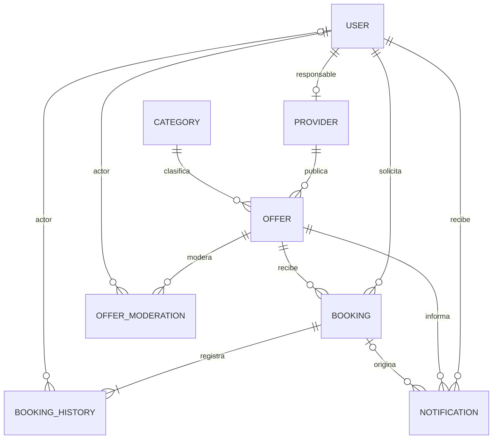

# USH Last Minute

## 1. Presentación

**Informe:** Implementación y evaluación final — Taller de Proyectos II.

**Aplicación:** https://ushlm.vercel.app/ · **Entrega final:** 20/11/2026.

**Bajada:** «Lo mejor de Ushuaia, a último momento». **Mensaje principal:** «Todavía estás a tiempo. Pagá menos».

Aplicación académica que conecta turistas con prestadores habilitados de Ushuaia para ofrecer descuentos en excursiones, estadías y alquileres de autos que comienzan dentro de las próximas 72 horas. El objetivo de la entrega es demostrar un circuito operativo con datos ficticios y evidencia reproducible.

| Dato académico | Valor |
|---|---|
| Materia | Taller de Proyectos II |
| Carrera | Tecnicatura Universitaria en Tecnología de la Información |
| Institución | Universidad Kennedy |
| Fecha de entrega final | 20/11/2026 |
| Modalidad | Individual |
| Fecha de revisión final | 20/11/2026, America/Argentina/Ushuaia |
| Integrante | Rodrigo Herrainz |
| Legajo | 237834 |
| Correo | rherrainz@alumnos.kennedy.edu.ar |
| Repositorio | https://github.com/rherrainz/ushlm |


Dominio propuesto: `ush-lm.ar`. Alternativas previstas: `ushlastminute.ar` y `ushlm.ar`. La aplicación está publicada en Vercel; los dominios propios continúan como propuesta y no son necesarios para acceder a la entrega.

## 2. Problema, solución y alcance

Los turistas necesitan encontrar oportunidades cercanas y conocer sus condiciones. Los prestadores necesitan ofrecer inventario remanente y confirmar únicamente la disponibilidad real. El administrador habilita prestadores y gestiona categorías y publicaciones.

La solución incluye tres perfiles: turista registrado, prestador asociado a una cuenta responsable única y administrador de Django. El registro público crea turistas; el administrador crea las cuentas prestadoras y su habilitación. No hay autoaprobación de prestadores.

Reglas implementadas:

- Solo prestadores habilitados con cuenta activa publican. Cada guardado de una publicación valida inicio futuro dentro de 72 horas, vencimiento futuro no posterior al inicio y fin posterior al inicio. Los borradores pueden prepararse antes de esa ventana.
- Cada oferta tiene fechas fijas. Excursiones: unidad `persona`; autos: unidad `auto`; alojamientos: unidad explícita y ocupación positiva obligatoria. No existe selector de períodos variables.
- Precio decimal positivo y menor al de referencia en la misma moneda y condiciones. La veracidad del precio anterior depende de la carga del prestador. Cupo no negativo y cantidades enteras positivas.
- El catálogo excluye ofertas vencidas, cerradas, sin cupo y prestadores suspendidos/inactivos. Filtra por categoría y fecha local de inicio. Por defecto ordena por mayor descuento porcentual, con vencimiento más próximo como desempate; conserva la opción de ordenar por vencimiento. El selector refleja el criterio aplicado, también sin parámetros o ante un criterio desconocido. No se comparan precios absolutos de monedas distintas.
- La edición general de una oferta **no escribe cupo ni versión**, aunque se agreguen esos campos al POST. Las ofertas nuevas creadas desde los formularios comienzan con cupo cero. El panel y la administración tienen una operación separada **Ajustar disponibilidad** para cargar el saldo completo.
- Cada ajuste verifica propietario o permiso administrativo, cuenta activa, cupo entero entre 0 y 2147483647 y versión esperada. Dentro de la transacción bloquea prestador y oferta y realiza una actualización condicionada a esa versión. Un formulario obsoleto no se aplica: exige volver a cargar y revisar el saldo. Confirmaciones, devoluciones y ajustes incrementan `stock_version`.
- Una pendiente no descuenta cupo ni garantiza disponibilidad. Se valida al solicitar y nuevamente al aceptar. La aceptación bloquea prestador, oferta y solicitud, confirma, descuenta inventario y agrega historial dentro de una transacción. No se acepta dos veces una solicitud.
- El detalle muestra precio por unidad, moneda y total antes de solicitar. JavaScript calcula con centavos enteros; **Recalcular total** ofrece una vista previa desde el servidor sin crear una solicitud. El servidor siempre calcula el total y no confía en precios o totales enviados por el navegador.
- El formulario incluye una referencia firmada de precio, moneda, descripción, condiciones y datos del servicio. Al solicitar se compara con la oferta actual bajo bloqueo. Si cambió, no se registra la solicitud: se muestran la información y el total actualizados, se conservan cantidad/contacto y se pide revisar antes de volver a enviar.
- La solicitud conserva una copia histórica de precio, moneda, descripción, condiciones y datos del servicio/prestador. Cambios posteriores no alteran esa copia. Un UUID único evita duplicados por reenvío del mismo formulario; el reenvío de una solicitud ya creada devuelve la existente, aunque la oferta haya cambiado después.
- El turista cancela pendientes propias. El prestador rechaza pendientes o cancela confirmadas propias con motivo obligatorio. El cupo se devuelve únicamente si la oferta sigue vigente y el prestador habilitado, una sola vez.
- Las pendientes vencen al expirar su publicación; el comando periódico y los listados materializan ese estado y su historial. Sin ejecutar el comando, el servidor igualmente impide aceptar una pendiente vencida. Cerrar o suspender una oferta no adelanta automáticamente el vencimiento de sus pendientes.
- Escrituras mediante POST y CSRF, validación del servidor y errores conservando los datos del formulario. Listados autenticados filtrados por propietario. Relaciones protegidas conservan actividad e historial; el administrador no puede borrar entidades ni editar solicitudes/historial directamente.

**Exclusiones:** cobros, integraciones de inventario externo, guías freelance, múltiples destinos y reseñas. Los pagos se coordinan con el prestador y el inventario externo se carga manualmente.

## 3. Tecnologías y arquitectura

Monolito Django con plantillas, CSS y JavaScript puntual. SQLite para desarrollo; PostgreSQL configurable para producción y pruebas de concurrencia. Fechas con zona horaria, presentadas en America/Argentina/Ushuaia. El contador usa el vencimiento persistido y no se reinicia al recargar; el servidor determina la vigencia efectiva.

| Componente | Versión utilizada |
|---|---|
| Python | 3.14.6 |
| Django | 5.2.19, rama LTS 5.2 |
| SQLite local | 3.54.0 |
| psycopg / psycopg-binary | 3.3.9 |
| asgiref / sqlparse | 3.13.0 / 0.6.1 |
| PostgreSQL | Neon, entorno desplegado y base aislada de evaluación |

Dependencias fijadas en [requirements.txt](requirements.txt). Las versiones provienen del entorno utilizado. Node.js es opcional para ejecutar las tres pruebas del cálculo de vista previa; no es una dependencia de ejecución de la aplicación.

- [config/settings.py](config/settings.py) y [rutas](config/urls.py): configuración y entorno.
- [modelos](market/models.py), [migración inicial](market/migrations/0001_initial.py) y [migración de inventario](market/migrations/0002_offer_stock_version_alter_offer_stock.py): datos, validaciones y restricciones. La segunda migración conserva el cupo existente e inicializa su versión en cero.
- [servicios](market/services.py): transacciones, comparación de versión, referencias firmadas, solicitudes, vencimientos e historial.
- [vistas](market/views.py), [formularios](market/forms.py), [administración](market/admin.py) y [plantillas](templates/market/): operaciones y permisos.
- [estilos](static/market/style.css), [contador](static/market/countdown.js) y [vista previa](static/market/booking-preview.js).
- [suite original](market/tests.py), [regresiones](market/test_regressions.py), [pruebas JavaScript](market/booking_preview.test.mjs) y [semilla](market/management/commands/seed_demo.py).



`User` es el modelo de autenticación de Django. El actor del historial puede ser nulo para eventos automáticos. Las relaciones de negocio usan `PROTECT` para evitar borrados en cascada. Las capturas de evaluación están en [evidencias](evidencias/).

## 4. Instalación y ejecución

Requisitos: Python 3.14 compatible con las dependencias fijadas, `venv` y `pip`. Desde la raíz del repositorio:

```sh
python3 -m venv .venv
source .venv/bin/activate
python -m pip install -r requirements.txt
cp .env.example .env
python manage.py migrate
python manage.py seed_demo --password 'ElegirUnaClaveLocal-2026!'
python manage.py runserver 127.0.0.1:8000
```

Abrir http://127.0.0.1:8000/. Para una instalación existente conservar `.env` y ejecutar `migrate`, sin volver a copiar el ejemplo ni recrear datos.

`.env.example` contiene configuración de desarrollo y una clave pública exclusiva para uso local. Para producción usar clave privada, `DJANGO_DEBUG=0`, hosts reales, HTTPS y revisar `check --deploy`. El lector de `.env` admite `CLAVE=valor` y comentarios completos; no interpreta expansión ni comillas. El entorno tiene precedencia. `.env`, bases SQLite y `.venv` están ignorados por Git.

La semilla crea categorías, un prestador habilitado, tres ofertas con fechas futuras relativas a la ejecución y las cuentas `turista_demo`, `prestador_demo` y `admin_demo`, con la contraseña elegida. Usa correos `example.invalid`. Es transaccional y no sobrescribe cuentas demo existentes. Para otra demostración actualizar fechas desde el panel o usar otra base vacía, migrar y ejecutar la semilla. No borrar bases con actividad real.

Programar periódicamente el vencimiento; no se instala una tarea del sistema automáticamente:

```sh
python manage.py expire_pending
```

**PostgreSQL: verificado en Neon.** Para repetir la evaluación en otro entorno, crear una base local y un usuario con permiso para crear la base de pruebas. Configurar el entorno y ejecutar:

```sh
export DATABASE_ENGINE=postgresql
export PGDATABASE=ushlm
export PGUSER=ushlm
export PGPASSWORD='ClaveLocalElegida'
export PGHOST=127.0.0.1
export PGPORT=5432
python manage.py migrate
python manage.py test --verbosity 2
python manage.py test market.tests.PostgreSQLConcurrencyTests --verbosity 2
```

Ejemplo opcional si Docker está instalado e iniciado:

```sh
docker run --name ushlm-pg -e POSTGRES_DB=ushlm -e POSTGRES_USER=ushlm -e POSTGRES_PASSWORD='ClaveLocalElegida' -p 127.0.0.1:5432:5432 -d postgres:17
```

Esperar que la base esté lista. Las pruebas crean y destruyen `test_ushlm`; no ejecutarlas contra producción. SQLite no acredita bloqueos de fila ni el comportamiento concurrente de PostgreSQL.

## 5. Guía de demostración

1. Ingresar al catálogo sin parámetros: el selector muestra **Mayor descuento**. Comparar porcentajes y elegir **Vencimiento más cercano** para cambiar el orden. Filtrar por categoría y fecha.
2. Abrir el detalle, revisar fechas fijas, unidad, ocupación, condiciones y prestador. Como turista, cambiar cantidad y observar el total. Con JavaScript desactivado, completar contacto y usar **Recalcular total**: aún no se crea una solicitud.
3. Solicitar una unidad con `turista_demo` o una cuenta nueva. Ver pendiente, total y copia histórica en **Mis solicitudes**. El cupo no cambia.
4. Como `prestador_demo`, aceptar desde **Panel prestador**. Cambian estado, cupo y versión; el turista ve confirmación e historial. Los pagos se coordinan directamente.
5. Reproducir el formulario antiguo: con cupo 2, abrir **Editar oferta** en una pestaña. Confirmar una unidad desde otra pestaña y guardar solo la descripción en la primera. El cupo permanece en 1. Repetir desde el formulario general de administración.
6. Abrir **Ajustar disponibilidad** dos veces para la misma oferta. Guardar un saldo desde la primera pestaña; al guardar desde la segunda aparece conflicto y no cambia el saldo. Usar el enlace para recargar, revisar el saldo y decidir un nuevo ajuste. Repetir desde `/admin/`, entrando en la oferta y su enlace **Ajustar disponibilidad**.
7. Abrir un detalle como turista y, desde otra sesión, cambiar precio o condiciones. Solicitar desde la pestaña original: se muestra aviso y total actualizado, sin crear la solicitud. Revisar y enviar nuevamente para registrar las nuevas condiciones. Un reenvío accidental no duplica la solicitud creada.
8. Enviar otra pendiente y cancelarla como turista; enviar otra y rechazarla como prestador. Cancelar una confirmada con motivo y comprobar devolución única si continúa vigente.
9. Crear una oferta desde el panel: comienza con cupo 0. Cargar disponibilidad mediante el ajuste separado. Probar un precio igual al anterior o inicio a más de 72 horas y observar errores. Los alojamientos requieren ocupación.
10. Como `admin_demo`, administrar categorías y prestadores. Suspender un prestador: sus ofertas desaparecen y no se confirman pendientes. Restaurar habilitación para continuar.
11. Crear una oferta con vencimiento cercano, enviar una pendiente y esperar. Ejecutar `expire_pending` y consultar estado e historial automático. Registrar otro turista: no ve solicitudes ajenas; otro prestador no accede a ofertas del primero.

Son operaciones conectadas a la base, con pruebas HTTP. La concurrencia PostgreSQL y el recorrido de navegador se verificaron el 20/11/2026; ver el apartado 10 y el cierre del apartado 11. La recuperación de contraseña no forma parte de la demostración: faltan configuración de correo y sus plantillas.

## 6. Estado y porcentaje de avance (corte histórico)

**Corte: 12/11/2026. Avance funcional con evidencia: 80/100 (80 %).** Estimación del alcance y su verificación; no es cobertura de líneas ni certificación de producción.

La ponderación asigna 80 puntos a capacidades operativas y 20 a verificaciones transversales. Solicitudes e inventario tienen mayor peso por su riesgo. Se conceden puntos operativos cuando existe comportamiento y prueba automatizada. Las verificaciones de concurrencia y navegador permanecen en cero hasta su ejecución. Las correcciones de regresión corresponden a capacidades ya incluidas y mantienen los pesos de la línea base.

| Capacidad | Peso | Estado | Puntos | Evidencia |
|---|---:|---|---:|---|
| Estructura, configuración, modelo, migraciones, trazabilidad | 10 | Implementada | 10 | settings, models, migraciones 0001/0002; check, migrate y pruebas de validación/protección de historial |
| Administración de categorías, prestadores y ofertas | 8 | Implementada | 8 | admin.py; pruebas de acceso, formulario antiguo y ajuste administrativo con permisos/conflictos |
| Registro, inicio y cierre de sesión | 8 | Implementada | 8 | auth, SignupForm; pruebas de registro, autenticación, CSRF y POST |
| Catálogo, filtros, orden, detalle y contador persistido | 12 | Implementada; revisión visual pendiente | 12 | catálogo/detalle/JS; filtros y prueba que distingue precio absoluto, descuento, vencimiento y desempate |
| Solicitud propia, copia histórica, total e idempotencia | 14 | Implementada | 14 | servicios, Booking; decimales, total previo, datos manipulados, información obsoleta, snapshot y reenvío |
| Panel propio, publicación, aceptación y rechazo | 14 | Implementada; concurrencia pendiente | 14 | panel, formulario sin inventario, ajuste versionado; regresiones de cupo, permisos y aceptación |
| Vencimiento, cancelaciones, devolución e historial | 14 | Implementada | 14 | expire_pending/transition; vencimiento, motivo, devolución única y cambio de versión |
| Verificación concurrente de inventario en PostgreSQL | 10 | Parcial: cuatro pruebas escritas, no ejecutadas | 0 | PostgreSQLConcurrencyTests; comandos §4 |
| Verificación en navegador, teléfono, teclado y contador | 10 | Parcial: interfaz implementada, recorrido pendiente | 0 | plantillas/CSS/JS; recorrido visual pendiente |
| **Total** | **100** | **Avance con evidencia** | **80** | **Supera 60 % bajo el método explicitado** |

Las pruebas SQLite acreditan comportamiento secuencial, incluida la detección de una versión obsoleta en envíos sucesivos. No prueban concurrencia real ni accesibilidad visual. Las pruebas JavaScript aíslan el cálculo; tampoco reemplazan un navegador.

**Ciclo de vida:** requisitos, arquitectura inicial, implementación, revisión de defectos y pruebas unitarias/integradas realizadas. Pendientes: validación visual de las correcciones, concurrencia y entrega académica. El avance del ciclo de vida se describe por etapas y se evalúa por separado del porcentaje funcional.

## 7. Pruebas y mantenimiento (registro de la revisión inicial)

```sh
source .venv/bin/activate
python manage.py check
python manage.py makemigrations --check --dry-run
python manage.py test --verbosity 2
node --test market/*.test.mjs
git diff --check
```

**Resultados de esta revisión:** migración 0002 aplicada a SQLite conservando los datos locales; comprobaciones Django sin incidencias y sin cambios de modelo pendientes. Suite Django: **52 pruebas, 48 aprobadas y 4 omitidas por requerir PostgreSQL**. Pruebas JavaScript: **3 aprobadas**, ejecutadas en Node con un entorno DOM simulado; no es una prueba visual. `git diff --check` sin errores.

La suite original mantiene precios/fechas/cantidades inválidos, ofertas excluidas, pendiente sin descuento de stock, aceptación/rechazo/vencimiento/cancelaciones, propiedad, copia histórica, idempotencia y protección del historial. [Las regresiones](market/test_regressions.py) agregan:

- Formulario del prestador y del administrador abierto antes de confirmar, guardado después: el cupo vendido no reaparece.
- POST con cupo/versión agregados a la edición general: ignorados por el formulario y excluidos de la escritura. Creación general con cupo cero.
- Dos ajustes secuenciales sobre la misma versión: el segundo entra en conflicto. Confirmación y devolución invalidan versiones anteriores. Reintentar ciegamente un ajuste fallido no lo vuelve válido.
- Cupos/versiones inválidos, propietarios ajenos, permisos administrativos y CSRF del panel.
- Orden predeterminado por porcentaje, desempate por vencimiento, orden alternativo y selector aplicado.
- `19.99 × 3 = 59.97`, vista previa del servidor sin crear solicitud, cantidades inválidas, precio/moneda/total manipulados, firma ausente/alterada y precio/condiciones modificados desde la apertura del formulario. Revisión y reenvío con la copia histórica actualizada.

**Estado histórico, superado por la evaluación del apartado 10: concurrencia PostgreSQL no verificada en ese corte.** La verificación se realizó con SQLite; no se dispuso de un servidor PostgreSQL activo. Las cuatro pruebas con dos conexiones, barrera e hilos comprueban último cupo, doble aceptación, doble devolución y ajustes simultáneos basados en una versión. Están escritas, pero omitidas en SQLite: ejecutarlas en PostgreSQL antes de producción y registrar resultados.

**Estado histórico de esa revisión: verificación visual pendiente.** La suite HTTP y las pruebas JavaScript no sustituyen el recorrido en un navegador. Falta recorrer la guía de demostración a 390 y 1280 px, navegar con teclado y revisar errores, conflictos de inventario, total, contador y ausencia de desbordes. No se cuenta con capturas ni resultados visuales documentados de esta versión.

Incidencias corregidas:

- El formulario general podía restaurar un cupo vendido: edición sin campos de inventario ni escrituras a esas columnas, tanto en panel como en administración; ajuste separado con versión y bloqueos en orden prestador → oferta → solicitud cuando corresponde.
- El catálogo priorizaba vencimiento: ahora prioriza porcentaje de descuento y sincroniza el selector con el criterio efectivo.
- Faltaba total previo y control de información obsoleta: vista previa decimal y validación de referencia firmada dentro de la transacción; cambios comerciales requieren revisión, sin creación silenciosa.

La carga de inventario externo sigue siendo manual: una versión válida impide aplicar un formulario obsoleto, pero no certifica que el saldo ingresado sea comercialmente correcto. El administrador no modifica solicitudes directamente. Mantener respaldos, ejecutar migraciones/pruebas al cambiar reglas y programar `expire_pending` en el entorno de ejecución.

## 8. Planificación y participación

| Prioridad | Tarea | Estado / dependencia |
|---|---|---|
| 1 | Base, configuración, modelo, migraciones | Realizada |
| 2 | Administración, cuentas y catálogo | Realizada |
| 3 | Solicitudes históricas y operaciones de prestador | Realizada |
| 4 | Vencimientos, cancelaciones y regresiones de esta revisión | Realizada; suite SQLite aprobada |
| 5 | Verificar cambios en navegador, teléfono y teclado | Recorrido ejecutado en IAB; segunda familia de navegador pendiente |
| 6 | Ejecutar suite PostgreSQL | Ejecutada en base aislada de Neon; ver resultados finales |
| 7 | Datos de entrega final: Universidad Kennedy, modalidad individual, 20/11/2026 | Completados |
| 8 | Revisar criterios de entrega | Matriz de cierre en apartado 11; aceptación con participantes pendiente |

Proyecto individual de Rodrigo Herrainz, para Universidad Kennedy, con entrega final el 20/11/2026. La implementación y su evolución se documentan mediante el código, las pruebas, las incidencias corregidas y el historial de Git.

## 9. Limitaciones y referencias

Estado histórico de la revisión previa: estaban pendientes la revisión visual, la concurrencia y los textos comerciales. La evaluación ejecutada el 20/11/2026 se detalla en el apartado 10; las ofertas continúan siendo ficticias. La aplicación está desplegada en Vercel con Neon y su evaluación remota se registra en el apartado 10. No incluye envío de correos, recuperación de contraseña operativa, integraciones ni cobros. La interfaz utiliza recursos geométricos CSS locales.

Referencias del proyecto: requisitos funcionales, código y pruebas del repositorio, [notas oficiales de Django 5.2](https://docs.djangoproject.com/en/6.0/releases/5.2/) y [página oficial de descargas y soporte](https://www.djangoproject.com/download/).

## 10. Implementación y evaluación final: Vercel + Neon

Implementación final: 20/11/2026. Proyecto Vercel `rherrainzs-projects/ushlm`, vinculado a este repositorio, con Django y base Neon gratuita en `iad1`. La tabla del apartado 6 conserva el corte histórico de avance; la evaluación final se registra al final de este apartado.

### Conectar desde GitHub

1. Crear un proyecto PostgreSQL en Neon y guardar su cadena de conexión. Usar una conexión agrupada (host con `-pooler`) para la aplicación; para migraciones, preferir la conexión directa. Ambas deben exigir `sslmode=require`. No compartir las cadenas ni incluirlas en Git.
2. En Vercel, importar `rherrainz/ushlm`, seleccionar la rama que contenga estos cambios y dejar la raíz en `./`. Usar la detección nativa de **Django**, sin carpeta `api`, sin reglas de reescritura y sin comandos de migración en el build. `.python-version` selecciona Python 3.14; el entrypoint es `config/wsgi.py`.
3. Configurar las siguientes variables antes del primer deploy:

| Variable | Valor |
|---|---|
| `DATABASE_URL` | Cadena de Neon, agrupada y con TLS. |
| `DJANGO_SECRET_KEY` | Secreto privado estable, generado con `python -c "import secrets; print(secrets.token_urlsafe(64))"`. |
| `DJANGO_DEBUG` | `0` |
| `DJANGO_ALLOWED_HOSTS` | Dominio asignado al proyecto; agregar dominios propios solo cuando estén conectados. Separar por comas, sin `https://`. |
| `DJANGO_CSRF_TRUSTED_ORIGINS` | Orígenes exactos, por ejemplo `https://tu-proyecto.vercel.app`; separados por comas. |

Vercel aporta `VERCEL=1` y sus URLs de despliegue; las URLs exactas se incorporan a los hosts permitidos. No se permite `DEBUG=1` ni fallback a SQLite en Vercel. Las conexiones PostgreSQL de la aplicación no se mantienen abiertas entre solicitudes y los cursores del servidor están deshabilitados para compatibilidad con el pool. Usar una base o rama Neon separada para Preview: los despliegues de prueba no deben escribir sobre la base productiva.

4. Vercel ejecuta `collectstatic` automáticamente y sirve CSS, JavaScript y estáticos de administración mediante su CDN. No es necesario instalar WhiteNoise para este destino ni cargar archivos en el disco de la función. Las sesiones y los datos del proyecto viven en PostgreSQL.
5. Preparar la base desde un entorno local confiable, antes de habilitar la demostración pública. Cargar la conexión **directa** en una variable `DATABASE_URL` de ese entorno y `DJANGO_SECRET_KEY` con el secreto correspondiente. No pegar secretos en comandos versionados. Ejecutar:

```sh
python manage.py migrate --noinput
python manage.py createsuperuser
python manage.py check
```

Crear usuarios de prueba y ofertas con fechas futuras. `seed_demo --password ...` sirve solo para una base aislada de evaluación; no ejecutar automáticamente en builds y no publicar la contraseña. Nunca volver a crear cuentas o migrar al recibir una petición HTTP. Las ofertas demo vencen: actualizar sus fechas y disponibilidad desde el panel antes de la exposición.

6. Desplegar en Vercel. Verificar la portada, el CSS/JS, `/admin/`, inicio/cierre de sesión, publicación, ajuste de cupo, solicitud, aceptación, cancelación y copia histórica. **URL pública comprobada: https://ushlm.vercel.app/**. **Fecha de implementación: 20/11/2026**.

### Pruebas antes de la puesta en marcha

El workflow `.github/workflows/tests.yml` ejecuta la suite con PostgreSQL 17, incluidas las pruebas concurrentes, además de las pruebas JavaScript. Se dispara al publicar cambios o abrir una PR. Su existencia no equivale a un resultado aprobado: revisar la ejecución en GitHub Actions y registrar el enlace.

Las pruebas de PostgreSQL deben apuntar a una base de evaluación con permiso de crear una base temporal, nunca a la base del sitio publicado. La suite SQLite conserva su utilidad local pero omite expresamente la concurrencia. La preparación no depende de tener Docker instalado para desplegar: GitHub Actions proporciona el servicio PostgreSQL de pruebas.

### Evaluación, mantenimiento y reversión

- La vigencia se controla en el servidor al confirmar. Los listados actualizan pendientes vencidas. Para materializarlas aun sin visitas, ejecutar periódicamente `python manage.py expire_pending` desde un ejecutor externo con las variables privadas de la base. No se promete una tarea en segundo plano permanente dentro de la función Vercel.
- Revisar errores y latencias desde los logs de Vercel sin imprimir contactos ni credenciales. Verificar que Neon esté disponible y dimensionar conexiones según el plan elegido.
- Mantener copias de seguridad y comprobar una restauración en una base separada. Un rollback de Vercel revierte código, **no** los datos ni las migraciones de PostgreSQL. Antes de cambios de esquema, verificar compatibilidad y disponer de respaldo.
- La aplicación sigue sin cobros, envío de correos ni recuperación de contraseña configurada. Son exclusiones del alcance; no deben anunciarse como funciones operativas.

| Evidencia de evaluación final | Resultado |
|---|---|
| Pruebas locales y configuración | 20/11/2026: 56 pruebas Django, 52 aprobadas y 4 omitidas por PostgreSQL; 3 pruebas JavaScript aprobadas; migraciones sincronizadas y 130 estáticos recopilados. |
| PostgreSQL real en Neon (base de evaluación separada) | 20/11/2026: 56 pruebas aprobadas, sin omisiones, en 639,271 s. Incluye las 4 de concurrencia. La base de pruebas y la base auxiliar se eliminaron al finalizar. |
| Recorrido en URL Vercel y adaptación móvil | Aprobado el circuito de login, total, solicitud, confirmación, descuento de cupo e historial; catálogo a 390 px sin desbordes. |
| Registro de incidentes y correcciones remotas | Error inicial de tablas ausentes resuelto con migraciones; formato de hora del contador fijado a 24 h; función ubicada junto a Neon. |

Documentación técnica de despliegue consultada el 20/11/2026: [Django en Vercel](https://vercel.com/docs/frameworks/full-stack/django). La suite en PostgreSQL real y el recorrido descrito fueron ejecutados; la automatización de GitHub Actions se configura adicionalmente y no se presenta como una ejecución observada.

### Registro de evaluación del entorno desplegado

- Migraciones de Django aplicadas en Neon; tres categorías y ofertas ficticias creadas. La contraseña aleatoria de las cuentas demo se conserva únicamente en un archivo local excluido de Git y no se publica en este README.
- Recorrido real en navegador: login como turista, detalle de oferta, total previo de dos unidades (ARS 118.000), envío pendiente y acceso con prestador. La solicitud ficticia #1 fue confirmada con autorización; el cupo bajó de 4 a 2 y el historial registró la transición. Se cerró la sesión del prestador al terminar.
- Catálogo revisado a 390 px, sin desbordamiento horizontal. Esto es una comprobación móvil acotada, no una auditoría completa de accesibilidad ni una prueba en todos los dispositivos.
- Evidencia del circuito: [confirmación y cupo](evidencias/confirmacion-demo.jpg). Evidencia móvil: [catálogo](evidencias/catalogo-movil.jpg).
- Durante la puesta en marcha se registraron errores iniciales por tablas todavía no migradas. Se aplicaron las migraciones y después se verificaron catálogo, login y solicitud correctamente.
- Se fijó la región de la función en `iad1`, junto a Neon, y el contador usa formato de 24 horas para evitar ambigüedad en el vencimiento.
- Las ofertas ficticias vencen según sus fechas reales. Antes de exponer el proyecto, actualizar fechas y cupos desde las cuentas autorizadas; no modificar automáticamente las condiciones de reservas existentes.

Resultado de pruebas de base de datos: **56/56 aprobadas con PostgreSQL de Neon**, sin omisiones. Las pruebas se ejecutaron sobre una base aislada, no sobre los datos de demostración publicados. La migración y la carga de datos de demostración del sitio también finalizaron correctamente.


## 11. Cierre del alcance original y aceptación

La tabla de 80 % del apartado 6 pertenece al avance del 12/11. No describe el estado actual. La revisión final contrasta también los requisitos de los módulos 1 y 2, para no confundir código desplegado con aceptación completa.

### Funciones completadas en la revisión final

- **RF-11, moderación:** la administración retira una oferta mediante una operación con motivo obligatorio, actor, fecha, estado anterior y estado nuevo. El evento se conserva en `OfferModeration`; el prestador recibe un aviso. La oferta retirada no puede republicarse y las solicitudes existentes se conservan. La edición administrativa general exige usar esa operación al cerrar una publicación.
- **RF-12, avisos:** nuevas solicitudes y cambios de estado generan avisos persistentes para la otra parte. Cada usuario consulta únicamente los propios y puede marcarlos como leídos mediante POST con CSRF. Un reenvío idempotente no duplica avisos. No son correos ni notificaciones push.
- **Diseño de publicación:** vista previa de los datos, descuento, fechas y condiciones sin guardar. Confirmar vuelve a validar en el servidor. El ajuste de cupo sigue separado para proteger la concurrencia.
- **Diseño del catálogo:** orden por precio exclusivamente dentro de ARS o USD, conservando el orden predeterminado por descuento. Paginación de 24 ofertas y conservación de filtros al cambiar página. Índices para estado/vencimiento e inicio.
- **Vencimiento en pantalla:** el contador deshabilita el envío cuando vence una oferta abierta. La validación del servidor continúa siendo la autoridad.
- **Recuperación:** comando `backup_project` con archivo nuevo de permisos 0600, instantánea consistente y precisión completa de fechas; procedimiento de restauración en una base aislada. Copias y credenciales excluidas de Git.

Las ilustraciones CSS locales se conservan como decisión visual de la demostración académica; no se presentan como fotografías de servicios reales. Pagos, correo, inventario externo, reseñas, guías y expansión territorial continúan fuera del alcance funcional acordado.

### Resultados de esta revisión

- Suite local: **66 pruebas Django**, 62 aprobadas y cuatro omitidas por requerir PostgreSQL; **cinco pruebas JavaScript aprobadas**. Las omisiones locales no acreditan concurrencia.
- `check`, migraciones sincronizadas y `git diff --check` sin incidencias.
- Navegador local aislado: solicitud de dos unidades enviada mediante teclado; aviso al prestador recibido y marcado como leído; vista previa de publicación revisada sin guardar. [Avisos](evidencias/avisos.jpg) y [vista previa](evidencias/vista-previa.jpg).
- Recuperación lógica local: comparación íntegra de usuarios, prestador, categorías, ofertas, solicitud, historial y aviso en otra base, con fechas completas y permisos de copia 0600. [Registro](evidencias/recuperacion.json). Una primera comprobación detectó la pérdida de microsegundos del serializador JSON estándar; se corrigió con un serializador de respaldo preciso y se repitió satisfactoriamente.
- PostgreSQL, suite de la revisión: **63 pruebas aprobadas sin omisiones**, incluidas las cuatro concurrentes, en 744,397 s; base de pruebas eliminada al finalizar.
- PostgreSQL, últimos cambios: **10 pruebas aprobadas sin omisiones** en una base aislada (124,211 s). La unión de ambas corridas cubre los 66 casos actuales; siete casos se repiten entre las corridas.
- Recuperación en PostgreSQL Neon: respaldo y restauración en otra base en 321,580 s; 500 ofertas ficticias, usuario, prestador y categoría conservados con igualdad de todos los campos. Esta muestra no contenía reservas; el ensayo local complementario sí incluyó solicitud e historial. [Registro PostgreSQL](evidencias/recuperacion-postgresql.json).
- Rendimiento y método reproducible: [procedimiento](docs/rendimiento.md), [script](scripts/benchmark_catalog.py) y [resultados](evidencias/rendimiento.json).

### Matriz de aceptación

| Requisitos del módulo 1 | Evidencia / estado |
|---|---|
| RF-01 a RF-10: cuentas, prestadores, publicaciones, catálogo, detalle, solicitudes, respuesta, estados, vencimientos y cancelaciones | Implementados; suites del circuito y regresiones; recorrido de solicitud y confirmación en Vercel. |
| RF-11: moderación con motivo y trazabilidad | Implementado con pruebas de permisos, motivo obligatorio, bloqueo de republicación y preservación de solicitudes. |
| RF-12: avisos y lectura | Implementado; pruebas de privacidad, idempotencia, POST/CSRF y lectura; [captura](evidencias/avisos.jpg). |
| RNF-01: 500 ofertas, 20 usuarios, p95 < 3 s | Prueba con 100 consultas: p95 **2,27 s**, sin errores. Servidor local con PostgreSQL Neon, no carga sobre producción. [Resultados](evidencias/rendimiento.json). |
| RNF-02: adaptación a 360 y 1366 px en dos navegadores | Revisados catálogo, login/solicitud y avisos a 360 px; avisos y vista previa a 1366 px en IAB. Falta la segunda familia de navegador y completar toda la matriz de pantallas en ambos anchos. |
| RNF-03: cuatro de cinco participantes, sin ayuda, en menos de cinco minutos | Cinco escenarios HTTP sintéticos aprobados el 21/11/2026; no sustituyen la evaluación humana, aún pendiente. [Protocolo, planilla y resultados sintéticos](docs/aceptacion-final.md). |
| RNF-04: HTTPS, contraseñas protegidas y aislamiento | HTTPS en Vercel, autenticación Django y pruebas de acceso entre propietarios. |
| RNF-05: integridad concurrente | Cuatro pruebas de concurrencia PostgreSQL y validaciones transaccionales. |
| RNF-06: respaldo diario y restauración | Comando y ensayos de recuperación local y PostgreSQL aprobados; programación diaria en almacenamiento privado pendiente, acordada como próximo paso. [Procedimiento](docs/recuperacion.md). |
| RNF-07: versionado, instrucciones y preparación por otra persona | Código, migraciones, instrucciones y pruebas disponibles. Falta acreditar la instalación independiente por otra persona. |
| RNF-08: teclado, etiquetas, foco y estados textuales | Login y envío de solicitud operados mediante teclado en el navegador; CSS con foco visible y estados textuales. Falta completar el recorrido de todos los controles previstos. |

El usuario confirmó que todavía no se ejecutó la prueba con cinco participantes y pidió preparar el protocolo. También acordó configurar el almacenamiento del respaldo diario como siguiente paso. Esas actividades no se registran como aprobadas ni se eliminan del alcance para elevar el porcentaje.

**Estado de cierre:** funcionalidades principales implementadas; aceptación integral abierta. No se declara el 100 % de todos los requisitos originales hasta completar y registrar las verificaciones pendientes. La demostración con datos ficticios tampoco acredita por sí sola un piloto con prestadores reales.


### Evaluación sintética complementaria — 21/11/2026

**5/5 recorridos automatizados aprobados**, con registro, catálogo, total, solicitud pendiente, confirmación, inventario, historial y avisos. Se probaron también cantidad inválida, aislamiento entre turistas, reenvío idempotente y orden por precio en una moneda. Datos ficticios, SQLite temporal y CSRF habilitado; producción sin modificaciones.

[Script reproducible](scripts/synthetic_acceptance.py) · [Resultados](evidencias/aceptacion-sintetica.json) · [Resumen y limitaciones](docs/aceptacion-final.md#pruebas-sintéticas-ejecutadas--21112026). Las simulaciones no se cuentan como participantes humanos ni cierran RNF-03.
