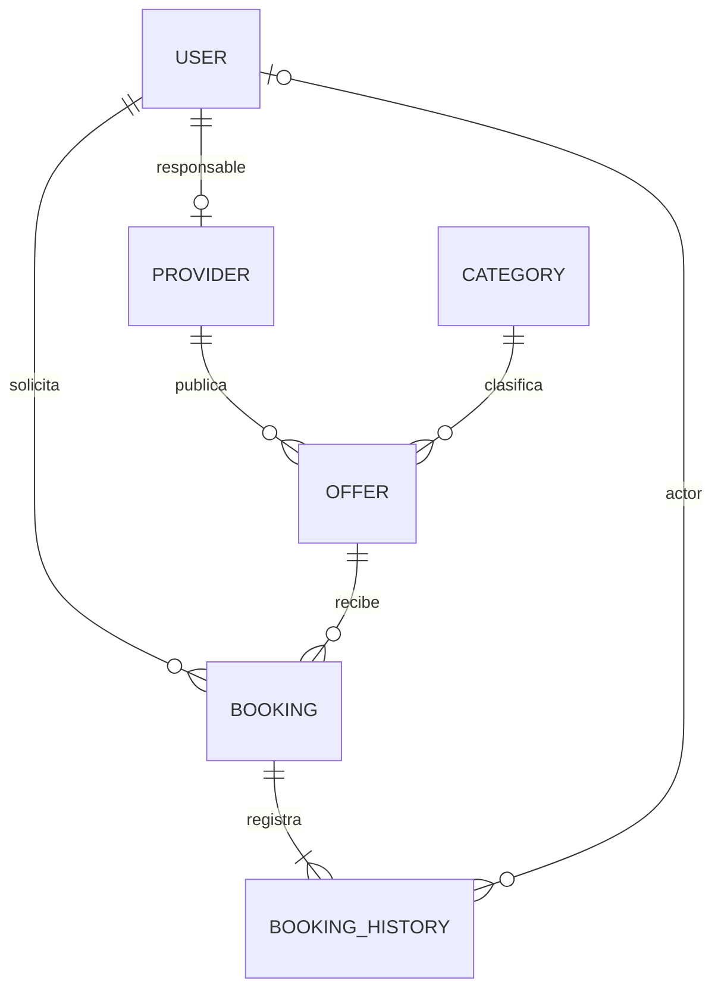

# USH Last Minute

## 1. Presentación

**Informe:** Avance de implementación y demostración funcional — Taller de Proyectos II.

**Bajada:** «Lo mejor de Ushuaia, a último momento». **Mensaje principal:** «Todavía estás a tiempo. Pagá menos».

Aplicación académica que conecta turistas con prestadores habilitados de Ushuaia para ofrecer descuentos en excursiones, estadías y alquileres de autos que comienzan dentro de las próximas 72 horas. El objetivo de la entrega es demostrar un circuito operativo con datos ficticios y evidencia reproducible.

| Dato académico | Valor |
|---|---|
| Materia | Taller de Proyectos II |
| Carrera | Tecnicatura Universitaria en Tecnología de la Información |
| Institución | Universidad Kennedy |
| Fecha de entrega | 13/11/2026 |
| Modalidad | Individual |
| Fecha de corte | 12/11/2026, America/Argentina/Ushuaia |
| Integrante | Rodrigo Herrainz |
| Legajo | 237834 |
| Correo | rherrainz@alumnos.kennedy.edu.ar |
| Repositorio | https://github.com/rherrainz/ushlm |


Dominio propuesto: `ush-lm.ar`. Alternativas previstas: `ushlastminute.ar` y `ushlm.ar`. No se configuraron dominios ni despliegues.

## 2. Problema, solución y alcance

Los turistas necesitan encontrar oportunidades cercanas y conocer sus condiciones. Los prestadores necesitan ofrecer inventario remanente y confirmar únicamente la disponibilidad real. El administrador habilita prestadores y gestiona categorías y publicaciones.

La solución incluye tres perfiles: turista registrado, prestador asociado a una cuenta responsable única y administrador de Django. El registro público crea turistas; el administrador crea las cuentas prestadoras y su habilitación. No hay autoaprobación de prestadores.

Reglas implementadas:

- Solo prestadores habilitados con cuenta activa publican. Cada guardado de una publicación valida inicio futuro dentro de 72 horas, vencimiento futuro no posterior al inicio y fin posterior al inicio. Los borradores pueden prepararse antes de esa ventana.
- Cada oferta tiene fechas fijas. Excursiones: unidad `persona`; autos: unidad `auto`; alojamientos: unidad explícita y ocupación positiva obligatoria. No existe selector de períodos variables.
- Precio decimal positivo y menor al de referencia en la misma moneda y condiciones. La veracidad del precio anterior depende de la carga del prestador. Cupo no negativo y cantidades enteras positivas.
- El catálogo excluye ofertas vencidas, cerradas, sin cupo y prestadores suspendidos/inactivos. Filtra por categoría y fecha local de inicio. Por defecto ordena por mayor descuento porcentual, con vencimiento más próximo como desempate; conserva la opción de ordenar por vencimiento. El selector refleja el criterio aplicado, también sin parámetros o ante un criterio desconocido. No se comparan precios absolutos de monedas distintas.
- La edición general de una oferta **no escribe cupo ni versión**, aunque se agreguen esos campos al POST. Las ofertas nuevas creadas desde los formularios comienzan con cupo cero. El panel y la administración tienen una operación separada **Ajustar disponibilidad** para cargar el saldo completo.
- Cada ajuste verifica propietario o permiso administrativo, cuenta activa, cupo entero entre 0 y 2147483647 y versión esperada. Dentro de la transacción bloquea prestador y oferta y realiza una actualización condicionada a esa versión. Un formulario obsoleto no se aplica: exige volver a cargar y revisar el saldo. Confirmaciones, devoluciones y ajustes incrementan `stock_version`.
- Una pendiente no descuenta cupo ni garantiza disponibilidad. Se valida al solicitar y nuevamente al aceptar. La aceptación bloquea prestador, oferta y solicitud, confirma, descuenta inventario y agrega historial dentro de una transacción. No se acepta dos veces una solicitud.
- El detalle muestra precio por unidad, moneda y total antes de solicitar. JavaScript calcula con centavos enteros; **Recalcular total** ofrece una vista previa desde el servidor sin crear una solicitud. El servidor siempre calcula el total y no confía en precios o totales enviados por el navegador.
- El formulario incluye una referencia firmada de precio, moneda, descripción, condiciones y datos del servicio. Al solicitar se compara con la oferta actual bajo bloqueo. Si cambió, no se registra la solicitud: se muestran la información y el total actualizados, se conservan cantidad/contacto y se pide revisar antes de volver a enviar.
- La solicitud conserva una copia histórica de precio, moneda, descripción, condiciones y datos del servicio/prestador. Cambios posteriores no alteran esa copia. Un UUID único evita duplicados por reenvío del mismo formulario; el reenvío de una solicitud ya creada devuelve la existente, aunque la oferta haya cambiado después.
- El turista cancela pendientes propias. El prestador rechaza pendientes o cancela confirmadas propias con motivo obligatorio. El cupo se devuelve únicamente si la oferta sigue vigente y el prestador habilitado, una sola vez.
- Las pendientes vencen al expirar su publicación; el comando periódico y los listados materializan ese estado y su historial. Sin ejecutar el comando, el servidor igualmente impide aceptar una pendiente vencida. Cerrar o suspender una oferta no adelanta automáticamente el vencimiento de sus pendientes.
- Escrituras mediante POST y CSRF, validación del servidor y errores conservando los datos del formulario. Listados autenticados filtrados por propietario. Relaciones protegidas conservan actividad e historial; el administrador no puede borrar entidades ni editar solicitudes/historial directamente.

**Exclusiones:** cobros, integraciones de inventario externo, guías freelance, múltiples destinos y reseñas. Los pagos se coordinan con el prestador y el inventario externo se carga manualmente.

## 3. Tecnologías y arquitectura

Monolito Django con plantillas, CSS y JavaScript puntual. SQLite para desarrollo; PostgreSQL configurable para producción y pruebas de concurrencia. Fechas con zona horaria, presentadas en America/Argentina/Ushuaia. El contador usa el vencimiento persistido y no se reinicia al recargar; el servidor determina la vigencia efectiva.

| Componente | Versión utilizada |
|---|---|
| Python | 3.14.6 |
| Django | 5.2.19, rama LTS 5.2 |
| SQLite local | 3.54.0 |
| psycopg / psycopg-binary | 3.3.9 |
| asgiref / sqlparse | 3.13.0 / 0.6.1 |
| PostgreSQL | Configurable; no ejecutado |

Dependencias fijadas en [requirements.txt](requirements.txt). Las versiones provienen del entorno utilizado. Node.js es opcional para ejecutar las tres pruebas del cálculo de vista previa; no es una dependencia de ejecución de la aplicación.

- [config/settings.py](config/settings.py) y [rutas](config/urls.py): configuración y entorno.
- [modelos](market/models.py), [migración inicial](market/migrations/0001_initial.py) y [migración de inventario](market/migrations/0002_offer_stock_version_alter_offer_stock.py): datos, validaciones y restricciones. La segunda migración conserva el cupo existente e inicializa su versión en cero.
- [servicios](market/services.py): transacciones, comparación de versión, referencias firmadas, solicitudes, vencimientos e historial.
- [vistas](market/views.py), [formularios](market/forms.py), [administración](market/admin.py) y [plantillas](templates/market/): operaciones y permisos.
- [estilos](static/market/style.css), [contador](static/market/countdown.js) y [vista previa](static/market/booking-preview.js).
- [suite original](market/tests.py), [regresiones](market/test_regressions.py), [pruebas JavaScript](market/booking_preview.test.mjs) y [semilla](market/management/commands/seed_demo.py).



`User` es el modelo de autenticación de Django. El actor del historial puede ser nulo para eventos automáticos. Las relaciones de negocio usan `PROTECT` para evitar borrados en cascada. Las capturas de la interfaz están pendientes de incorporación.

## 4. Instalación y ejecución

Requisitos: Python 3.14 compatible con las dependencias fijadas, `venv` y `pip`. Desde la raíz del repositorio:

```sh
python3 -m venv .venv
source .venv/bin/activate
python -m pip install -r requirements.txt
cp .env.example .env
python manage.py migrate
python manage.py seed_demo --password 'ElegirUnaClaveLocal-2026!'
python manage.py runserver 127.0.0.1:8000
```

Abrir http://127.0.0.1:8000/. Para una instalación existente conservar `.env` y ejecutar `migrate`, sin volver a copiar el ejemplo ni recrear datos.

`.env.example` contiene configuración de desarrollo y una clave pública exclusiva para uso local. Para producción usar clave privada, `DJANGO_DEBUG=0`, hosts reales, HTTPS y revisar `check --deploy`. El lector de `.env` admite `CLAVE=valor` y comentarios completos; no interpreta expansión ni comillas. El entorno tiene precedencia. `.env`, bases SQLite y `.venv` están ignorados por Git.

La semilla crea categorías, un prestador habilitado, tres ofertas con fechas futuras relativas a la ejecución y las cuentas `turista_demo`, `prestador_demo` y `admin_demo`, con la contraseña elegida. Usa correos `example.invalid`. Es transaccional y no sobrescribe cuentas demo existentes. Para otra demostración actualizar fechas desde el panel o usar otra base vacía, migrar y ejecutar la semilla. No borrar bases con actividad real.

Programar periódicamente el vencimiento; no se instala una tarea del sistema automáticamente:

```sh
python manage.py expire_pending
```

**PostgreSQL: pendiente hasta preparar producción.** Para verificarlo, crear una base local y un usuario con permiso para crear la base de pruebas. Configurar el entorno y ejecutar:

```sh
export DATABASE_ENGINE=postgresql
export PGDATABASE=ushlm
export PGUSER=ushlm
export PGPASSWORD='ClaveLocalElegida'
export PGHOST=127.0.0.1
export PGPORT=5432
python manage.py migrate
python manage.py test --verbosity 2
python manage.py test market.tests.PostgreSQLConcurrencyTests --verbosity 2
```

Ejemplo opcional si Docker está instalado e iniciado:

```sh
docker run --name ushlm-pg -e POSTGRES_DB=ushlm -e POSTGRES_USER=ushlm -e POSTGRES_PASSWORD='ClaveLocalElegida' -p 127.0.0.1:5432:5432 -d postgres:17
```

Esperar que la base esté lista. Las pruebas crean y destruyen `test_ushlm`; no ejecutarlas contra producción. SQLite no acredita bloqueos de fila ni el comportamiento concurrente de PostgreSQL.

## 5. Guía de demostración

1. Ingresar al catálogo sin parámetros: el selector muestra **Mayor descuento**. Comparar porcentajes y elegir **Vencimiento más cercano** para cambiar el orden. Filtrar por categoría y fecha.
2. Abrir el detalle, revisar fechas fijas, unidad, ocupación, condiciones y prestador. Como turista, cambiar cantidad y observar el total. Con JavaScript desactivado, completar contacto y usar **Recalcular total**: aún no se crea una solicitud.
3. Solicitar una unidad con `turista_demo` o una cuenta nueva. Ver pendiente, total y copia histórica en **Mis solicitudes**. El cupo no cambia.
4. Como `prestador_demo`, aceptar desde **Panel prestador**. Cambian estado, cupo y versión; el turista ve confirmación e historial. Los pagos se coordinan directamente.
5. Reproducir el formulario antiguo: con cupo 2, abrir **Editar oferta** en una pestaña. Confirmar una unidad desde otra pestaña y guardar solo la descripción en la primera. El cupo permanece en 1. Repetir desde el formulario general de administración.
6. Abrir **Ajustar disponibilidad** dos veces para la misma oferta. Guardar un saldo desde la primera pestaña; al guardar desde la segunda aparece conflicto y no cambia el saldo. Usar el enlace para recargar, revisar el saldo y decidir un nuevo ajuste. Repetir desde `/admin/`, entrando en la oferta y su enlace **Ajustar disponibilidad**.
7. Abrir un detalle como turista y, desde otra sesión, cambiar precio o condiciones. Solicitar desde la pestaña original: se muestra aviso y total actualizado, sin crear la solicitud. Revisar y enviar nuevamente para registrar las nuevas condiciones. Un reenvío accidental no duplica la solicitud creada.
8. Enviar otra pendiente y cancelarla como turista; enviar otra y rechazarla como prestador. Cancelar una confirmada con motivo y comprobar devolución única si continúa vigente.
9. Crear una oferta desde el panel: comienza con cupo 0. Cargar disponibilidad mediante el ajuste separado. Probar un precio igual al anterior o inicio a más de 72 horas y observar errores. Los alojamientos requieren ocupación.
10. Como `admin_demo`, administrar categorías y prestadores. Suspender un prestador: sus ofertas desaparecen y no se confirman pendientes. Restaurar habilitación para continuar.
11. Crear una oferta con vencimiento cercano, enviar una pendiente y esperar. Ejecutar `expire_pending` y consultar estado e historial automático. Registrar otro turista: no ve solicitudes ajenas; otro prestador no accede a ofertas del primero.

Son operaciones conectadas a la base, con pruebas HTTP. Las correcciones de esta revisión no tienen validación visual ni de concurrencia PostgreSQL ejecutadas. La recuperación de contraseña no forma parte de la demostración: faltan configuración de correo y sus plantillas.

## 6. Estado y porcentaje de avance

**Corte: 12/11/2026. Avance funcional con evidencia: 80/100 (80 %).** Estimación del alcance y su verificación; no es cobertura de líneas ni certificación de producción.

La ponderación asigna 80 puntos a capacidades operativas y 20 a verificaciones transversales. Solicitudes e inventario tienen mayor peso por su riesgo. Se conceden puntos operativos cuando existe comportamiento y prueba automatizada. Las verificaciones de concurrencia y navegador permanecen en cero hasta su ejecución. Las correcciones de regresión corresponden a capacidades ya incluidas y mantienen los pesos de la línea base.

| Capacidad | Peso | Estado | Puntos | Evidencia |
|---|---:|---|---:|---|
| Estructura, configuración, modelo, migraciones, trazabilidad | 10 | Implementada | 10 | settings, models, migraciones 0001/0002; check, migrate y pruebas de validación/protección de historial |
| Administración de categorías, prestadores y ofertas | 8 | Implementada | 8 | admin.py; pruebas de acceso, formulario antiguo y ajuste administrativo con permisos/conflictos |
| Registro, inicio y cierre de sesión | 8 | Implementada | 8 | auth, SignupForm; pruebas de registro, autenticación, CSRF y POST |
| Catálogo, filtros, orden, detalle y contador persistido | 12 | Implementada; revisión visual pendiente | 12 | catálogo/detalle/JS; filtros y prueba que distingue precio absoluto, descuento, vencimiento y desempate |
| Solicitud propia, copia histórica, total e idempotencia | 14 | Implementada | 14 | servicios, Booking; decimales, total previo, datos manipulados, información obsoleta, snapshot y reenvío |
| Panel propio, publicación, aceptación y rechazo | 14 | Implementada; concurrencia pendiente | 14 | panel, formulario sin inventario, ajuste versionado; regresiones de cupo, permisos y aceptación |
| Vencimiento, cancelaciones, devolución e historial | 14 | Implementada | 14 | expire_pending/transition; vencimiento, motivo, devolución única y cambio de versión |
| Verificación concurrente de inventario en PostgreSQL | 10 | Parcial: cuatro pruebas escritas, no ejecutadas | 0 | PostgreSQLConcurrencyTests; comandos §4 |
| Verificación en navegador, teléfono, teclado y contador | 10 | Parcial: interfaz implementada, recorrido pendiente | 0 | plantillas/CSS/JS; recorrido visual pendiente |
| **Total** | **100** | **Avance con evidencia** | **80** | **Supera 60 % bajo el método explicitado** |

Las pruebas SQLite acreditan comportamiento secuencial, incluida la detección de una versión obsoleta en envíos sucesivos. No prueban concurrencia real ni accesibilidad visual. Las pruebas JavaScript aíslan el cálculo; tampoco reemplazan un navegador.

**Ciclo de vida:** requisitos, arquitectura inicial, implementación, revisión de defectos y pruebas unitarias/integradas realizadas. Pendientes: validación visual de las correcciones, concurrencia y entrega académica. El avance del ciclo de vida se describe por etapas y se evalúa por separado del porcentaje funcional.

## 7. Pruebas y mantenimiento

```sh
source .venv/bin/activate
python manage.py check
python manage.py makemigrations --check --dry-run
python manage.py test --verbosity 2
node --test market/booking_preview.test.mjs
git diff --check
```

**Resultados de esta revisión:** migración 0002 aplicada a SQLite conservando los datos locales; comprobaciones Django sin incidencias y sin cambios de modelo pendientes. Suite Django: **52 pruebas, 48 aprobadas y 4 omitidas por requerir PostgreSQL**. Pruebas JavaScript: **3 aprobadas**, ejecutadas en Node con un entorno DOM simulado; no es una prueba visual. `git diff --check` sin errores.

La suite original mantiene precios/fechas/cantidades inválidos, ofertas excluidas, pendiente sin descuento de stock, aceptación/rechazo/vencimiento/cancelaciones, propiedad, copia histórica, idempotencia y protección del historial. [Las regresiones](market/test_regressions.py) agregan:

- Formulario del prestador y del administrador abierto antes de confirmar, guardado después: el cupo vendido no reaparece.
- POST con cupo/versión agregados a la edición general: ignorados por el formulario y excluidos de la escritura. Creación general con cupo cero.
- Dos ajustes secuenciales sobre la misma versión: el segundo entra en conflicto. Confirmación y devolución invalidan versiones anteriores. Reintentar ciegamente un ajuste fallido no lo vuelve válido.
- Cupos/versiones inválidos, propietarios ajenos, permisos administrativos y CSRF del panel.
- Orden predeterminado por porcentaje, desempate por vencimiento, orden alternativo y selector aplicado.
- `19.99 × 3 = 59.97`, vista previa del servidor sin crear solicitud, cantidades inválidas, precio/moneda/total manipulados, firma ausente/alterada y precio/condiciones modificados desde la apertura del formulario. Revisión y reenvío con la copia histórica actualizada.

**Concurrencia PostgreSQL no verificada.** La verificación se realizó con SQLite; no se dispuso de un servidor PostgreSQL activo. Las cuatro pruebas con dos conexiones, barrera e hilos comprueban último cupo, doble aceptación, doble devolución y ajustes simultáneos basados en una versión. Están escritas, pero omitidas en SQLite: ejecutarlas en PostgreSQL antes de producción y registrar resultados.

**Verificación visual de las correcciones pendiente.** La suite HTTP y las pruebas JavaScript no sustituyen el recorrido en un navegador. Falta recorrer la guía de demostración a 390 y 1280 px, navegar con teclado y revisar errores, conflictos de inventario, total, contador y ausencia de desbordes. No se cuenta con capturas ni resultados visuales documentados de esta versión.

Incidencias corregidas:

- El formulario general podía restaurar un cupo vendido: edición sin campos de inventario ni escrituras a esas columnas, tanto en panel como en administración; ajuste separado con versión y bloqueos en orden prestador → oferta → solicitud cuando corresponde.
- El catálogo priorizaba vencimiento: ahora prioriza porcentaje de descuento y sincroniza el selector con el criterio efectivo.
- Faltaba total previo y control de información obsoleta: vista previa decimal y validación de referencia firmada dentro de la transacción; cambios comerciales requieren revisión, sin creación silenciosa.

La carga de inventario externo sigue siendo manual: una versión válida impide aplicar un formulario obsoleto, pero no certifica que el saldo ingresado sea comercialmente correcto. El administrador no modifica solicitudes directamente. Mantener respaldos, ejecutar migraciones/pruebas al cambiar reglas y programar `expire_pending` en el entorno de ejecución.

## 8. Planificación y participación

| Prioridad | Tarea | Estado / dependencia |
|---|---|---|
| 1 | Base, configuración, modelo, migraciones | Realizada |
| 2 | Administración, cuentas y catálogo | Realizada |
| 3 | Solicitudes históricas y operaciones de prestador | Realizada |
| 4 | Vencimientos, cancelaciones y regresiones de esta revisión | Realizada; suite SQLite aprobada |
| 5 | Verificar cambios en navegador, teléfono y teclado | Pendiente de ejecución |
| 6 | Ejecutar suite PostgreSQL | Pendiente hasta preparar producción; requiere base de pruebas |
| 7 | Datos de entrega: Universidad Kennedy, modalidad individual, 13/11/2026 | Completados |
| 8 | Revisar criterios de entrega | Pendiente académico |

Proyecto individual de Rodrigo Herrainz, para Universidad Kennedy, con entrega el 13/11/2026. La implementación y su evolución se documentan mediante el código, las pruebas, las incidencias corregidas y el historial de Git.

## 9. Limitaciones y referencias

Pendientes reales: revisión visual de las correcciones, concurrencia en PostgreSQL y revisión de textos/condiciones comerciales. La aplicación es una demostración local; no incluye configuración de producción, envío de correos, recuperación de contraseña operativa, integraciones ni cobros. La interfaz utiliza recursos geométricos CSS locales.

Referencias del proyecto: requisitos funcionales, código y pruebas del repositorio, [notas oficiales de Django 5.2](https://docs.djangoproject.com/en/6.0/releases/5.2/) y [página oficial de descargas y soporte](https://www.djangoproject.com/download/).
